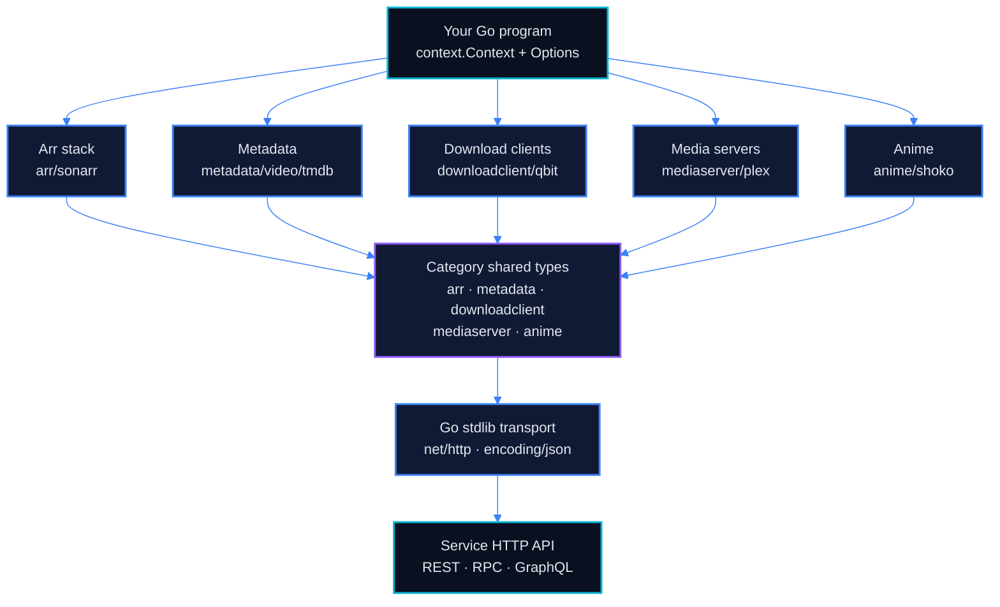

<!-- markdownlint-disable MD013 MD023 MD033 MD036 MD041 -->
<!-- A centred header needs inline HTML, a banner image, indented headings and
     badge lines past 80 columns, so those five rules are off for this file.
     Same directive style as docs/adr/0000-template.md. The prose below still
     wraps at 80. -->
<div align="center">

  

  <!-- README-STANDARD badge block: one group, fixed order (docs/README-STANDARD.md) -->
  <!-- 1 release/version -->
  [](https://github.com/plurano/goenvoy/releases)
  [](https://go.dev)
  <!-- 2 CI/build -->
  [](https://github.com/plurano/goenvoy/actions/workflows/ci.yml)
  <!-- 3 security/scorecard -->
  [](https://github.com/plurano/goenvoy/actions/workflows/security-scan.yml)
  [](https://scorecard.dev/viewer/?uri=github.com/plurano/goenvoy)
  [](https://www.bestpractices.dev/projects/15901)
  [](https://app.codacy.com/gh/plurano/goenvoy/dashboard)
  [](https://coderabbit.ai)
  <!-- 4 standards -->
  [](AGENTS.md)
  [](docs/principles.md)
  [](CONTRIBUTING.md)
  <!-- 5 licence -->
  [](LICENSE)
  <!-- 6 support -->
  [](https://github.com/sponsors/lusoris)
  [](https://ko-fi.com/lusoris)

  **Pure-stdlib Go client libraries for media automation, metadata, and download APIs**

  *71 modules covering 63+ services in a multi-module monorepo with zero external dependencies*

</div>

goenvoy is a collection of Go client libraries for media automation, metadata,
and download service APIs — 71 modules covering 63+ services. Designed as a
multi-module monorepo, it allows importing only what you need, from a single
library to an entire category, using only Go's standard library.

The name **goenvoy** combines **Go** and **envoy** — a messenger sent to deal
with another party on someone's behalf, which is the role each module plays for
one service API. It is pronounced "go-EN-voy" (/ɡoʊ ˈɛnvɔɪ/).

**[Principles](docs/principles.md)** · [Architecture Decisions](docs/adr/) ·
[Contributing](CONTRIBUTING.md)

---

## Why goenvoy

- **Pure stdlib** — zero external dependencies, using only Go's standard
  library ([ADR-0001](docs/adr/0001-pure-stdlib.md)).
- **Context-aware** — every request method takes `context.Context` for
  cancellation and timeouts ([docs/principles.md](docs/principles.md)).
- **Functional options** — `WithHTTPClient`, `WithTimeout`, `WithHeader`, and
  service-specific options ([ADR-0004](docs/adr/0004-functional-options.md)).
- **Type-safe errors** — modules commonly expose `APIError`, with fields that
  vary by service; for example, NZBGet exposes an RPC code and message. See
  [ADR-0005](docs/adr/0005-api-error-type.md) and the
  [package reference](https://pkg.go.dev/github.com/golusoris/goenvoy/downloadclient/nzbget#APIError).
- **OAuth2 support** — device code, authorisation code, PKCE, and refresh flows
  where applicable ([ADR-0007](docs/adr/0007-oauth2-flows.md)).
- **Thoroughly tested** — `httptest`-based unit tests with the race detector
  enabled and no live API calls
  ([ADR-0006](docs/adr/0006-httptest-only-tests.md)).

## Get started

### Install

Import a specific service library:

```go
go get github.com/golusoris/goenvoy/arr/sonarr
```

Or import shared category types:

```go
go get github.com/golusoris/goenvoy/arr
```

### Usage

```go
package main

import (
    "context"
    "fmt"
    "log"

    "github.com/golusoris/goenvoy/arr/sonarr"
)

func main() {
    client, err := sonarr.New("http://localhost:8989", "your-api-key")
    if err != nil {
        log.Fatal(err)
    }

    ctx := context.Background()

    // Get system status
    status, err := client.GetSystemStatus(ctx)
    if err != nil {
        log.Fatal(err)
    }
    fmt.Printf("%s version %s\n", status.AppName, status.Version)

    // Get all series
    series, err := client.GetAllSeries(ctx)
    if err != nil {
        log.Fatal(err)
    }
    fmt.Printf("Total series: %d\n", len(series))
}
```

Most clients follow `New(baseURL, apiKey, opts...)`; some differ. For example,
`kitsu.New` takes options only, while `nzbget.New` takes a base URL, username,
and password. See [ADR-0003](docs/adr/0003-new-constructor-shape.md) and each
[package reference](https://pkg.go.dev/github.com/golusoris/goenvoy) for the
exact signature.

## At a glance



### Categories

| Category | Module | Services |
| --- | --- | --- |
| **Arr Stack** | `github.com/golusoris/goenvoy/arr` | Sonarr, Radarr, Lidarr, Readarr, Whisparr (v2+v3), Prowlarr, Bazarr, Seerr, Autobrr, Mylar3, Jackett, NZBHydra2 |
| **Metadata** | `github.com/golusoris/goenvoy/metadata` | TMDb, TheTVDB, Fanart.tv, OMDb, TVmaze, AniList, Kitsu, AniDB, MAL, Trakt, Simkl, Letterboxd, ListenBrainz, MusicBrainz, StashBox, TPDB, OpenSubtitles, Last.fm, Discogs, TheAudioDB, Open Library, Google Books, Spotify, Deezer, IGDB, RAWG, Steam, MobyGames, SteamGridDB, RetroAchievements, ScreenScraper, Hasheous, LaunchBox |
| **Download Clients** | `github.com/golusoris/goenvoy/downloadclient` | qBittorrent, Transmission, Deluge, rTorrent, SABnzbd, NZBGet |
| **Media Servers** | `github.com/golusoris/goenvoy/mediaserver` | Plex, Jellyfin, Emby, Tautulli, Audiobookshelf, Komga, Navidrome, Kavita, Stash, Tdarr |
| **Tools** | `github.com/golusoris/goenvoy/tools` | FlareSolverr |
| **Anime** | `github.com/golusoris/goenvoy/anime` | Shoko Server |

### Structure

Each category has a base module with shared types, plus sub-modules for
individual services:

```text
goenvoy/
├── arr/              # shared *arr types + base client
│   ├── sonarr/       # Sonarr v3 client
│   ├── radarr/       # Radarr v3 client
│   ├── lidarr/       # Lidarr client
│   ├── readarr/      # Readarr client
│   ├── whisparr/     # Whisparr v2 + v3 (Eros) client
│   ├── prowlarr/     # Prowlarr client
│   ├── bazarr/       # Bazarr client
│   ├── seerr/        # Seerr client
│   ├── autobrr/      # Autobrr client
│   ├── cleanuparr/   # Cleanuparr client
│   ├── mylar/        # Mylar3 client
│   ├── jackett/      # Jackett client
│   └── nzbhydra/     # NZBHydra2 client
├── tools/            # adjacent automation utilities
│   └── flaresolverr/ # FlareSolverr Cloudflare-bypass client
├── metadata/         # shared metadata types (Rating, Image, Person, ...)
│   ├── video/        # TMDb, TheTVDB, Fanart.tv, OMDb, TVmaze, OpenSubtitles
│   ├── anime/        # AniList, Kitsu, AniDB, MAL
│   ├── music/        # MusicBrainz, Last.fm, Discogs, TheAudioDB, Spotify, Deezer
│   ├── tracking/     # Trakt, Simkl, Letterboxd, ListenBrainz
│   ├── adult/        # StashBox, TPDB
│   ├── book/         # Google Books, Open Library
│   └── game/         # IGDB, RAWG, Steam, MobyGames, SteamGridDB, RetroAchievements, ScreenScraper, Hasheous, LaunchBox
├── downloadclient/   # shared download types + Downloader interface
│   ├── qbit/         # qBittorrent WebUI client
│   ├── transmission/ # Transmission RPC client
│   ├── deluge/       # Deluge JSON-RPC client
│   ├── rtorrent/     # rTorrent XMLRPC client
│   ├── sabnzbd/      # SABnzbd client
│   ├── nzbget/       # NZBGet JSON-RPC client
│   └── queue/        # Unified read-only queue snapshot
├── mediaserver/      # shared media server types
│   ├── plex/         # Plex Media Server client
│   ├── jellyfin/     # Jellyfin client
│   ├── emby/         # Emby client
│   ├── tautulli/     # Tautulli client
│   ├── audiobookshelf/ # Audiobookshelf client
│   ├── komga/        # Komga client
│   ├── navidrome/    # Navidrome client
│   ├── kavita/       # Kavita client
│   ├── stash/        # StashApp GraphQL client
│   └── tdarr/        # Tdarr client
├── anime/            # shared anime types
│   └── shoko/        # Shoko Server client
```

## Guides and reference

- [Documentation site](https://plurano.github.io/goenvoy/) — published guides,
  architecture decisions, and upstream API notes.
- [Principles](docs/principles.md) — coding rules, SEI CERT Go practices, Go
  style, supply-chain commitments, wire protocols, and testing standards.
- [Architecture decision records](docs/adr/) — Nygard-format records for module
  boundaries, constructors, functional options, error types, and OAuth2 flows.
- [Upstream API references](docs/upstream/) — per-service upstream API
  documentation URLs, target versions, and verification dates.
- [Issue and PR triage runbook](docs/triage-runbook.md) — maintainer workflow
  for reviewing issues, pull requests, and automated checks.
- [Go package reference](https://pkg.go.dev/github.com/golusoris/goenvoy) —
  generated API documentation and runnable examples on `pkg.go.dev`.

## Contribute

Requires Go 1.26+. See [CONTRIBUTING.md](CONTRIBUTING.md) for full details.

```bash
# Set up workspace (local dev, links every module in the tree)
go work init && find . -name 'go.mod' -not -path './.workingdir/*' -exec dirname {} \; | xargs go work use

# Run all tests
make test-all

# Lint all modules
make lint-all

# Tidy all modules
make tidy-all

# Format all modules
make fmt-all
```

## Support

If goenvoy saves you time, you can support maintenance through
[GitHub Sponsors](https://github.com/sponsors/lusoris) or
[Ko-fi](https://ko-fi.com/lusoris).

## Roadmap and releases

Each module is versioned and released independently using per-module Git tags
of the form `<category>/<service>/vX.Y.Z` (see
[ADR-0002](docs/adr/0002-per-module-semver.md)).
[release-please](.github/workflows/release-please.yml) writes release notes and
each module's `CHANGELOG.md` from Conventional Commit subjects. The root
[CHANGELOG.md](CHANGELOG.md) holds repository-wide changes from before that.
Published releases and supply-chain attestations are available on the
[GitHub Releases](https://github.com/plurano/goenvoy/releases) page.

## Upstream and licence

goenvoy is an original multi-module Go library collection released under the
[MIT Licence](LICENSE). Target upstream service versions and documentation links
are tracked in [docs/upstream/](docs/upstream/).

## Standards and governance

- Pure stdlib ([ADR-0001](docs/adr/0001-pure-stdlib.md)), enforced in CI by
  `depguard`.
- Per-module independent semantic versioning
  ([ADR-0002](docs/adr/0002-per-module-semver.md)) via `<path>/vX.Y.Z` tags.
- Every release ships cosign-signed checksums, an SPDX SBOM, and SLSA Level 3
  provenance ([.github/workflows/release.yml](.github/workflows/release.yml)).
- Pull requests run `golangci-lint`, `gosec`, `govulncheck`, and race-enabled
  tests for each changed module. Changes to `ci.yml`, `.golangci.yml`, or
  `tools/coverage-thresholds.json` run all modules
  ([.github/workflows/ci.yml](.github/workflows/ci.yml)).
- [AGENTS.md](AGENTS.md) and [CLAUDE.md](CLAUDE.md) define agent-assisted
  development conventions.
- [docs/adr/](docs/adr/) records architectural decisions in Nygard format.

See [CONTRIBUTING.md](CONTRIBUTING.md) and [SECURITY.md](SECURITY.md).

<!-- praetor:readme-governance:start -->
[![Documentation Governance][praetor-docs-badge]][praetor-docs-runs]

Praetor manages this repository's declared governance policy. This managed
block records adoption state; it is not a verification certificate.

**Verification**: `make verify-all` runs the repository's configured
verification cascade.

**HISS Audit**: `praetorctl audit` enforces policy, generated-surface
integrity, and the debt ratchet.

**Context Sync**: `praetorctl compile-context --verify` verifies every
generated agent context against `AGENTS.md`.

**Documentation**: `make docs-lint` enforces locked Markdown style and the
private scratch-link policy.

**Debt Baseline**: `.standards-baseline.json` anchors the debt ratchet at
5 recorded infractions; audit forbids growth.

[praetor-docs-badge]: https://github.com/plurano/goenvoy/actions/workflows/praetor-docs.yml/badge.svg
[praetor-docs-runs]: https://github.com/plurano/goenvoy/actions/workflows/praetor-docs.yml
<!-- praetor:readme-governance:end -->
